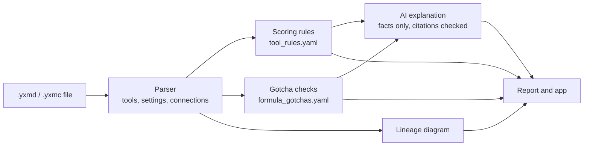

# Alteryx-to-Redshift Workflow Analyzer

**Turns Alteryx workflows into plain-English migration assessments for Amazon Redshift: what each workflow does, how hard it is to rebuild in SQL, which logic won't translate cleanly, and what to do about it.**

**[Try the live demo](https://alteryx-redshift-workflow-analyzer.streamlit.app/)** · samples included, no install needed

**[Watch the 2-minute demo](https://www.youtube.com/watch?v=DiiojtaZb7U)**

Matched expert difficulty ratings on all 4 test workflows and flagged all 14 planted migration risks.


## Why this exists

Moving analytics from Alteryx to a cloud warehouse looks like a translation job, but the risk is in the details a literal translation gets wrong:

- **Alteryx is forgiving where SQL isn't.** A date format with the wrong separator, text that isn't quite a number, a blank that's empty rather than NULL: Alteryx often copes, and the migrated SQL fails or, worse, returns slightly different numbers.
- **Same name, different behavior.** Alteryx's Unique keeps the first row per key; SQL's `DISTINCT` only removes identical rows. Redshift's `AVG` on whole numbers returns a whole number. Union matches columns by name; `UNION ALL` matches them by position.
- **Hidden logic.** Macros live in separate files, Python tools have no SQL equivalent, and Multi-Row Formulas depend on sort order.

Teams planning a migration need to know, workflow by workflow, where these traps are before they commit to a plan. This tool reads the workflow file and tells them.

## How it works



1. **Code extracts the facts.** The parser reads the workflow's XML: every tool, its settings (formulas, filters, joins, RegEx patterns, Python code), and every connection, including macros.
2. **Transparent rules score difficulty.** Each Alteryx tool has a difficulty, points, and a Redshift equivalent in an editable YAML file. Points convert to a 1–10 score.
3. **Gotcha checks look inside the logic.** Formula text and tool settings are checked for known migration traps, each with evidence and Redshift advice.
4. **AI explains, it doesn't decide.** Claude turns the facts into a summary, risks, and next steps. It never sees the workflow file, can't change the score, and must cite tools by ID. Every cited ID is checked against the workflow, and invented ones are flagged.
5. **Results are shown** as a report (HTML and Markdown), a lineage diagram colored by difficulty, and a Streamlit app.

## Example

A savings workflow with a Python tool, a batch macro, RegEx parsing, and running totals:


Selected findings:

| Severity | Finding |
| --- | --- |
| High | Python tool has no SQL equivalent (and Redshift no longer supports Python UDFs) |
| High | Macro logic lives in a separate file and must be migrated too |
| Medium | RegEx needs three Redshift parameters to behave the same: case-insensitive, capture group, Perl-style pattern |
| Medium | Running total depends on sort order; becomes a window function with an explicit frame clause |
| Medium | Unmatched Join records are used downstream; needs a separate query |

## Results

| Workflow | Expert rating | Tool score | Planted risks flagged |
| --- | --- | --- | --- |
| WF1 Active members | 2 | 2 | none planted |
| WF2 Cases by member | 4 | 4 | 3 of 3 |
| WF3 Monthly trend | 6 | 6 | 5 of 5 |
| WF4 Savings report | 9 | 9 | 6 of 6 |

All 5 AI explanations passed the citation check. Testing also surfaced a real risk that wasn't planted: a year typed directly into a formula, now caught by its own rule.

**Honest caveat:** the scoring rules were calibrated on these same 4 workflows, so matching scores is expected rather than independent proof. Testing on fresh workflows is the next step. Full details in [docs/evaluation.md](docs/evaluation.md).

## Limits

- **Reads logic, not data.** Data-dependent issues, such as a date format that doesn't match the actual data, are flagged as risks to test, not detected directly.
- **Doesn't estimate effort or cost.** It scores difficulty and lists risks; planning hours is left to people.
- **Redshift first.** The rules target Amazon Redshift; other warehouses would need their own rule files.
- **Tools not in the rules** are flagged as unknown and scored conservatively, so they're never silently under-scored.

## Run it

Requires Python 3.11 or newer.

```bash
git clone https://github.com/FaizaLag/alteryx-to-redshift-workflow-analyzer.git
cd alteryx-to-redshift-workflow-analyzer
python -m venv .venv
.venv\Scripts\Activate.ps1        # Windows; on Mac/Linux: source .venv/bin/activate
pip install -r requirements.txt
streamlit run app.py
```

The app opens in your browser. Upload a workflow or try one of the samples.

**AI explanations are optional.** To enable them, create a `.env` file in the project folder with your own Anthropic API key:

```
ANTHROPIC_API_KEY=your-key-here
```

Everything else works without a key. The workflow file never leaves your computer; only a summary of extracted facts (file names, no paths) is sent when you request an AI explanation.

**Command line**, for batch runs:

```bash
python src/parser.py tests/workflows --save     # parse workflows to JSON
python src/score.py outputs/parsed --save        # difficulty scores
python src/gotchas.py outputs/parsed --save      # migration gotchas
python src/ai_summary.py all --save              # AI explanations (needs a key)
python src/report.py                             # HTML and Markdown reports
```

## Project structure

```
app.py                     Streamlit app
src/
  parser.py                reads .yxmd / .yxmc files into structured data
  score.py                 rule-based difficulty score
  gotchas.py               formula and structure checks
  lineage.py               Mermaid data-flow diagrams
  ai_summary.py            Claude API call and citation check
  report.py                HTML and Markdown reports
  pipeline.py              in-memory pipeline used by the app
rules/
  tool_rules.yaml          difficulty and Redshift equivalent per tool
  formula_gotchas.yaml     migration checks with severity and advice
prompts/assessment.md      instructions for the AI explanation
templates/                 report layouts
tests/
  workflows/               4 test workflows and a batch macro
  data/                    synthetic input data and generator
  answer_key.md            expert ratings, written before the tool existed
  expected_outputs/        Alteryx results, for validating migrated SQL
docs/evaluation.md         results and limits
outputs/                   generated scores, gotchas, diagrams, and reports
```

## About the test data

All data is synthetic, generated by `tests/data/generate_test_data.py`: invented IDs, birth years, and codes. No real people, organizations, or employer data.

## About me

Built by **Faiza Laghrari**, Senior Data Analytics Consultant. I turn messy data into reliable pipelines, checks, and reporting people can trust.

- **ETL and automation:** Alteryx, SAS, SQL, Python
- **Cloud data and BI:** Amazon Redshift, AWS, QuickSight, Tableau
- **Data quality:** automated checks on inbound and outbound files, reconciliation, migration risk assessment
- **AI-assisted analytics:** tools like this one, where code extracts the facts and AI explains them

**25+ years in data, with deep experience in healthcare and benefits.** I've built and automated data processes for Fortune 500 clients in SAS and Alteryx, including HR, payroll, and third-party vendor files, and delivered dashboards and reporting pipelines in Redshift, QuickSight, and Tableau.

[LinkedIn](https://www.linkedin.com/in/faiza-laghrari) · [Upwork](https://www.upwork.com/freelancers/~017170247a35786650)
